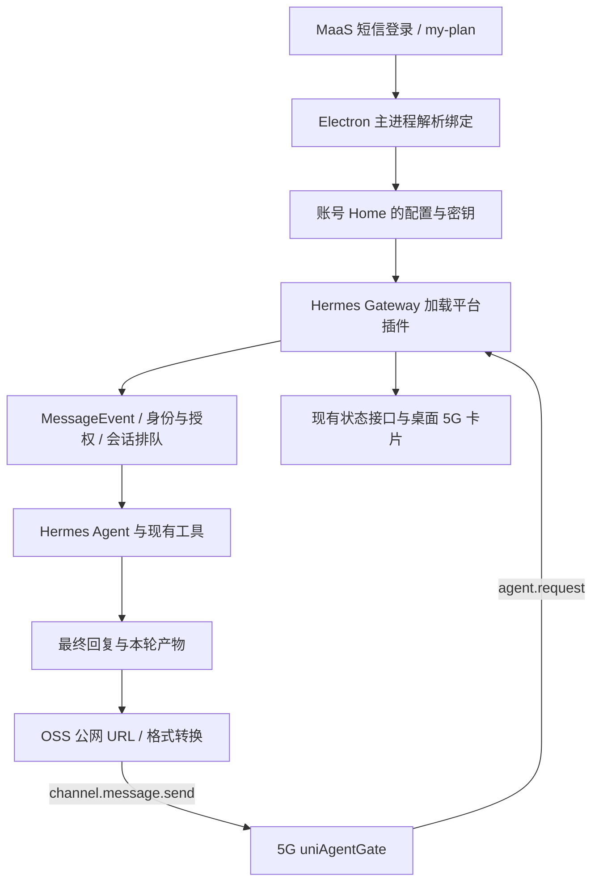

# uniAgentGate 5G 消息迁移调研与实施方案

日期：2026-10-19。本文保留初始调研和实施设计。协议适配器、登录个人凭据自动绑定和账号网关启动已开展实现，进度及验证限制见 [第一阶段迁移记录](uniagentgate-migration-progress.md)。未连接生产网关或发送短信。

后续授权适配以迁移记录为准：真实上行携带 `sa_…` 外部会话标识，初始设计中的“按登录手机号授权”不能用于比较该标识，已改为经过个人 Agent 连接验证的上游授权委托。

调研基线：

- 来源：`UniClaw` 的 `uniwork_release`，`ce575e5cfb7972925f245ecfec3f5e0feaa02e60`。通过 `git show/git grep <ref>` 读取，未切换或修改其工作区。
- 目标：`hermes-agent` 当前 `release`，`0f90d4c894acfe9bef978c16f3e00d02de59ba54`。
- 来源路径前缀：下文 `backend/` 指 `libs/hexagent_demo/backend/hexagent_api/`；`frontend/` 指 `libs/hexagent_demo/frontend/src/`。
- 事实以这两个本地提交为准，不表示已验证远端最新分支、线上接口响应或运营商投递结果。

## 1. 结论与范围

迁移对象是完整的“登录发放个人 Agent 凭据 → 网关注册与长连接 → 手机来信触发 Agent → 最终文本/文件下发 → 状态与恢复”链路。

推荐采用 **独立的 Hermes 平台插件 + 新版现有账号登录链路 + 现有消息平台页面**。保留旧协议客户端中可独立复用的部分，重写旧 `ChannelsRuntime` 与 HexAgent 会话的耦合。模型、工具执行、历史、排队、Profile 归属和授权交给 Hermes。

本次明确区分三类名称：

| 名称 | 本次处理 |
| --- | --- |
| `uniagentgate` | 必迁；旧版个人 5G RCS/短信网关接入，协议为 `uag.agent.v1` |
| `unibot` | 独立的另一套 5G 插件网关，存在自己的绑定、协议、媒体和长连接；不随本次自动迁入 |
| `agentIdCloud/agentKeyCloud` | 旧登录响应保留但桌面自动绑定不消费；云端接入另定范围，不能当作个人凭据回退 |

旧实现没有 SIP/语音通话、RCS 交互卡片或方式 B 的 Agent 流式事件下发。这些不是此次补齐旧功能所必需的工作。

## 2. 旧版实际具备的能力

| 功能 | 实际行为与迁移要求 | 来源定位 |
| --- | --- | --- |
| 登录自动绑定 | 消费短信登录 `data.plan` 内的 `ipUrl/agentIdPersonal/agentKeyPersonal`；兼容 my-plan 内的 `uniagentgate.{gateway_url,agent_id,agent_sk}` | `config.py:1403`、`frontend/authApi.ts:47`、`frontend/hooks/useAuth.ts:230`、`frontend/api.ts:2253` |
| 配置合并 | 字段缺失保留现有绑定；显式 `uniagentgate: null` 清理绑定；不完整/错误对象保留最后可用值 | `config.py:1425` |
| 多 Agent 归属 | 无团队时绑定全局 Claw；有团队时绑定第一个启用的 leader，移除同网关同 ID 的重复绑定；每个配置的 Agent 有独立连接 | `config.py:1463`、`channels/runtime.py:1261` |
| 凭据轮换 | 比较完整 `(gateway_url, agent_id, agent_sk)`；相同且存活不重连，变化先停旧连接再启新连接；解绑停止连接 | `channels/runtime.py:610,1261` |
| 注册与认证 | `POST /v1/agent-runtimes/register`，以 Agent SK 换 session token；请求含 Agent ID、时间戳、应用版本和请求 ID | `channels/uniagentgate/auth.py:82` |
| WebSocket 协议 | `/v1/agent-runtimes/connect`；Bearer session token、`X-Agent-Id`、`X-UAG-Protocol-Version: uag.agent.v1`；等待 accepted/rejected 首帧 | `channels/uniagentgate/stream.py::_connect_once` |
| 心跳与恢复 | WS 心跳决定连接生命周期；HTTP 心跳仅诊断，失败不驱动重注册；瞬断 1–30 秒抖动退避；过期重注册；被其他客户端接管则停止争抢 | `channels/uniagentgate/stream.py::_run/_http_heartbeat_loop/_connect_once` |
| 鉴权失败边界 | 注册 4xx 停止，服务/网络失败最多三次尝试；WS unauthorized/session_expired 连续失败最多三轮恢复，被接受的连接重置恢复预算 | 同上；历史修复 `610c667c`、`872beb42` |
| 入站文本与附件 | `agent.request` 携带手机号、session/turn/request ID 和 inputs；当前取第一个非空 text 和第一个 file_url；附件 URL 直接下载后入会话 | `channels/uniagentgate/protocol.py::AgentRequest`、`channels/runtime.py:2282,3313` |
| 入站确认与去重 | 要求 ACK 的来信先回协议 ACK，再用 message ID 去重；客户端缓存 300 秒/512 条；耗时 Agent 回调另起任务，不阻塞 socket 接收 | `channels/uniagentgate/stream.py::_handle_agent_request/_is_duplicate` |
| 每条来信独立执行 | 不加合并窗口；同一旧 Claw 会话用锁串行，每条消息保留自己的附件与回复上下文 | `channels/runtime.py:1374,2282`、`test_uniagentgate_inbound.py` |
| 最终回复 | 方式 A：`channel.message.send`；一次普通回复合并最终文字和可用媒体，不发送工具进度/工作中气泡；保留 Markdown 链接的 URL | `channels/runtime.py:2921`、`stream.py::send_channel_message` |
| 下行确认 | 等待对应 `in_reply_to` 的业务 ACK，`ok=false` 报失败，超时 8 秒报失败，记录 downlink_msg_ids | `channels/uniagentgate/protocol.py::parse_ack`、`stream.py::send_channel_message` |
| 文件回传 | 收集本轮 PresentToUser 文件，下载旧沙箱产物，经 OSS 上传获得公网 URL；支持原生媒体和不支持格式的文本下载链接 | `channels/runtime.py:3425`、`pre_upload.py::upload_bytes_get_url` |
| 连接状态与手动恢复 | starting/running/degraded/failed/stopped，错误原因和 retry_available；只重试设置页对应的全局/leader 客户端，不影响其他通道 | `channels/runtime.py:832,1766,1795`、`routes/channels.py:267` |
| 界面与密钥处理 | 状态卡片、聊天区通道徽标、中文/英文文案；配置响应遮蔽 SK，遮蔽占位值不会写回真密钥 | `frontend/components/ClawTab.tsx:1566`、`ChatArea.tsx:361`、`config.py:2021`、`routes/config.py:818` |

### 文件格式规则不能遗漏

- 原生图片：JPG/JPEG、PNG。
- 原生音频：AMR、MP3、M4A；WAV 先转 MP3。
- 原生视频：MP4、WEBM。
- 上述原生媒体上限为旧代码的 **20 MiB**；超限跳过，旧实现没有自动改成下载链接。
- PDF、Office 文档、GIF 等不在原生白名单中的格式走下载链接；支持的媒体不额外重复附下载链接。
- 下载、转码或上传某个文件失败，不阻止其余文件和最终文字下发；无可用 OSS 服务时旧版跳过文件。
- 公网 URL 必须能被 5G 网关取回。桌面预览地址、本机路径和旧 `ossPath` 短标识不能直接用作 `media[].url`。

### 旧代码的实现边界

这些是迁移时需要明确的事实，不能写成已有保证：

1. 握手解析了 `ack_deadline_ms/ack_max_retries`，但下行发送仍使用默认构帧参数和固定 8 秒等待，没有完整实现协商后的下行重发策略。
2. 协议 ACK 表示收到了请求，不表示模型执行成功，更不表示手机已收到短信；下行业务 ACK 也不能直接宣称为运营商终端送达回执。
3. 去重是内存窗口，进程重启后不保证恰好一次处理；旧回调报错时该 message ID 也已经进入去重缓存。
4. 长连接分发任务未形成完整的任务登记与排空机制，迁移时应完善停止、轮换时的任务和 pending ACK 清理。
5. 旧版会记录完整下行报文和 ACK；报文可能含手机号、消息内容或签名 URL，不宜把这类日志测试原样当作新版要求。

## 3. 新版已有能力与缺口

| 新版位置 | 已有能力 | 仍需实现 |
| --- | --- | --- |
| `apps/desktop/electron/login/session.ts` | 主进程短信登录、加密身份存储、恢复、到期管理；Renderer 仅获展示字段 | 当前 `parseIdentity/login` 不读取和同步登录响应中的 5G plan 凭据 |
| `apps/desktop/electron/login/plan.ts` | my-plan 请求、套餐及模型目录校验 | `MaasPlan/parsePlan` 仅保留模型字段，不消费 5G 绑定；不能依赖当前模型解析器隐式保留附加字段 |
| `apps/desktop/electron/entry_local/prepare-account.ts` | 按 UID 隔离账号 Home，启动前原子准备模型、Key、MCP 和插件配置 | 5G 凭据写入、插件安装启用，以及已绑定账号的网关启动/恢复 |
| `gateway/platform_registry.py`、`hermes_cli/plugins.py::register_platform` | 平台插件注册、配置识别、适配器工厂、状态/授权/发送路由接入 | uniagentgate 平台插件本身 |
| `gateway/platforms/base.py`、`event.py`、`session_identity.py` | 入站事件、会话历史、媒体路径、审批控制、身份路由、发送账本、Profile 作用域 | 协议字段映射、回信上下文与插件媒体投递策略 |
| `hermes_cli/web_server_messaging.py:229` | 自动从平台注册表构造目录 | 插件注册后可进入目录；目前目录主要描述环境变量字段，非密钥 YAML 字段需用实际配置路径写入 |
| `hermes_cli/web_routers/messaging.py:809,868,942` | 查询状态、配置凭据/启停、测试；命名 Profile 可通知 multiplexer 重建 | 现有 test 只是配置及运行状态检查，不等同于旧版在线 register；未提供旧版语义的单平台失败后手动重试入口 |
| `apps/desktop/src/app/messaging/platform-card.tsx:66`、`index.tsx:242` | 5G 标题、描述、待接入卡片及多语言文案 | 当前显式 `pending`、按钮禁用、过滤状态请求；需要接真实平台和重试 |
| `entry_local/uniai-toolkit-config.ts` | 账号 Home 已配置 UniAI-Toolkit MCP | 未找到旧 `PreUploadService` 的等价通用字节上传封装；需接现有 MCP 客户端做 OSS 流程 |
| `plugins/desktop-deliverables` | 桌面产物观察与输出标记 | 目前以 `platform == desktop` 为条件，不能假设会收集 uniagentgate 会话的文件 |
| `apps/desktop/electron/share-gateway.ts` | 受管 HTML 静态分享 | 只支持分享 HTML，不是任意 RCS 二进制媒体上传服务 |

注意：当前短信登录使用 `/app/login/smsLogin`，旧分支后端代理使用 `/app/gateway/login/smsLogin`。需要确认现有入口是否也返回 `data.plan` 的个人凭据，不能为了读取字段直接替换整套新版登录实现。

## 4. 推荐架构与代码落点



### 4.1 插件归属

按根 `AGENTS.md` 和 `plugins/AGENTS.md` 的第三方服务集成规则，建议插件源码独立维护，通过发行包或固定版本安装到该账号的 `$HERMES_HOME/plugins/uniagentgate`，不要新增 core model tool，也不要把 MaaS 登录、厂商 HTTP 客户端塞进 `gateway/run.py`。

当前定制发行已有 `apps/desktop/assets/artifact-share-plugin` 安装到账号 Home 的模式。若随 UniWork 发货，可参照这个模式承载插件；服务器发行安装同一份插件，不依赖 Electron 常驻或 Renderer 提供身份。独立仓库依赖/提交固定版本。

建议插件内部按职责组织：

```text
uniagentgate/
  plugin.yaml
  __init__.py       # register(ctx)，只注册平台/必要命令
  adapter.py        # BasePlatformAdapter：connect/disconnect/send/入站事件
  auth.py           # register/heartbeat，版本从 Hermes 版本接口注入
  protocol.py       # 复用并校验旧 envelope 编解码
  stream.py         # WS、心跳、恢复、去重、pending ACK
  media.py          # 类型白名单、WAV 转码、媒体 URL、链接回退
  upload.py         # 使用该 Profile 的 MCP/OSS 客户端
```

`protocol.py`、`auth.py`、`stream.py` 是保留原作者历史后移植的主要来源；需要替换旧包导入、ChannelHealth、旧 Electron 版本查找方式和生命周期接口。旧 `channels/runtime.py` 只抽取 uniagentgate 有关逻辑，不整文件复制，也不迁入 HexAgent AgentManager/Claw store/SSE/sandbox manager。

### 4.2 绑定、存储与启动

1. 在主进程创建独立的绑定解析结果，至少区分“缺失 / 清除 / 有效 / 无效”。5G 解析不依赖模型目录是否可用，不能因模型字段异常吞掉合法 5G 凭据，也不能因 5G 可选字段异常阻止合法账号登录。
2. 消费当前登录 `data.plan` 的个人字段；my-plan 兼容旧 nested 对象。两者冲突时定义来源/版本顺序，拒绝迟到结果覆盖更新后的绑定。
3. URL、Agent ID、enabled、超时和媒体行为进入账号/Profile 的 `config.yaml`；SK 进入其 secret store 或 `.env`。登录 token、模型 Key、Agent SK、短期 session token 四者各用各的认证链路。
4. 只向 Renderer 返回是否绑定、脱敏标识、运行状态和安全错误信息；不新增回传 SK/登录原文的 IPC。
5. 用当前 UID 对应的账号 Home 准备文件。首期个人绑定建议落在该账号默认 Profile；专家 Profile 不复制同一凭据。若后续支持指定专家接收，显式配置 Hermes 路由。
6. 相同绑定不重启；轮换先停止旧连接，再启新连接。单网关同 Agent ID 只能有一个消费端，资源锁应按规范化 `(gateway_url, agent_id)` 标识，不能仅按 SK；SK 轮换后身份仍相同。
7. 使用 scoped secret reader，捕获所属 Home 传给后台任务；不读进程全局默认账号的凭据，不修改全局 `os.environ`。
8. 补齐该账号已绑定情况下的网关启动/恢复。现有消息页阶段一明确没有自动恢复网关，单纯保存 enabled 不会产生在线连接。启动失败应显示网关状态，不把账号登录判为失败。
9. 沿用现有账号退出事务中的进程和网关清理。区分关闭窗口、完整退出和注销；不要用通用 Hermes 的网关常驻说明覆盖定制 Desktop MT 的实际生命周期。

配置形态建议如下，字段为实施设计，不代表当前已支持 uniagentgate：

```yaml
platforms:
  uniagentgate:
    enabled: true
    gateway_url: https://<5g-gateway>
    agent_id: <personal-agent-id>
    gateway_restart_notification: false
    typing_indicator: false

display:
  platforms:
    uniagentgate:
      streaming: false
      tool_progress: 'off'
      interim_assistant_messages: false
      long_running_notifications: false
      busy_ack_detail: false
      busy_steer_ack_enabled: false
```

SK 例如用 `UNIAGENTGATE_AGENT_SK` secret 传入插件。其他非密钥字段不另增 `HERMES_*` 环境变量。配置示例还不是“只发最终结果”的全部保证：必须实际核对审批/澄清、排队提示、错误通知、启动通知与发送工具路径。

### 4.3 入站、授权与会话

- `agent.request` 转为 `MessageEvent`；通过 `self.build_source(...)` 生成 source，`self.handle_message(event)` 进入正常网关路径，不直接调用 Agent。
- 手机号作为用户/聊天身份，Gateway Agent ID 作为连接身份，远端 session_id/turn_id/request_id/trace_id 作为独立关联数据。不要用 turn_id 建立新 Hermes 会话，也不要把远端 session_id 当成本地数据库会话 ID。
- reply context 按入站消息绑定并贯穿排队，不能用一个 adapter 级 `last_phone/last_turn`。并发两部手机、忙碌队列和断线重连都要回给正确的号码及原 session/turn。
- 凭据变更后的旧轮次不能自动借用新账号/新 Agent 的连接下发；应带连接身份/代次检查并记录明确结果。
- 旧版同一 Claw/leader 的来信共用会话，存在跨号码上下文共享；首期建议按“账号 + Profile + 接收 Agent 身份 + 手机号”隔离，复用 Hermes 的会话键机制。桌面可查看 5G 会话，不自动把所有 5G 来信注入一个正在打开的 PC 会话。
- 这是用户可见差异：如产品必须实现“短信与桌面同一会话”，需显式指定绑定关系并限制为该账号已授权手机号，不能全局共用 `claw`。
- 校验上游 agent_id、接收号码和输入形状；仍走 Hermes 授权策略。已认证网关并不等于所有电话号码都是该本机账号的所有者。不得简单把 `internal` 或其他信任位设为真绕过授权。
- 旧版无合并窗口；Hermes 具备 FIFO，但基础层也有文本 debounce、照片合并与打断路径。应使用现有队列且关闭该通道的合并/打断，先检查当前 per-Profile 配置能否表达；若只能改变同 Profile 所有通道，补最小通用 per-platform 策略入口，不能悄悄改变其他消息平台。
- 忙碌中的 `/stop`、审批/澄清回复等须继续经过两层 guard 的既有控制路径，不能被“每条消息串行等待”锁死。

### 4.4 最终回复、计费与媒体

保留方式 A，不把 Hermes token stream 转成逐条短信。配置为静默进度，并在协议适配器明确区分协议控制帧、必要交互消息和最终业务消息。

**文字加媒体的合并是一个实际框架适配点。** `BasePlatformAdapter._process_message_background` 当前先 `_send_final_text`，再 `_deliver_attachments`；queued follow-up 等路径也有媒体投递。仅实现 `send`、`send_image`、`send_document` 会变成多条下行。

实施时先验证现有 adapter override 是否能覆盖正常、排队、文件独立回复等路径；若不能，增加一个有默认实现的通用最终回复投递入口，统一携带文字和媒体，由该插件组合一次 `channel.message.send`。默认实现维持其他平台行为，并保留发送账本、媒体失败记录、Profile 作用域及控制交互。不要用定时器猜测“附件是否都到了”来拼消息，也不要为了一个厂商在 runner 中加特判。

产物链路使用 Hermes 本轮 `MEDIA:`/受控附件及终端后端文件解析。旧 PresentToUser 事件不原样移植；当前 `desktop-deliverables` 的桌面判断也不能直接视为 5G 已有产物支持。复用可用的路径过滤与本轮文件证据，避免把工作目录中无关文件全量上传。

OSS 上传优先使用已配置的 UniAI-Toolkit MCP 客户端，保留“获取上传地址 → 上传字节 → 确认/取得下载链接”的流程与按 Home 隔离的去重缓存。不能为此再开一条无归属的全局 MCP 连接；MCP 生命周期、重新配置和 shutdown 均交给所属运行时。当前没有完整的旧上传封装，需实现并实测。

WAV→MP3 通过 Hermes 的平台资源/FFmpeg 解析设施，依赖由 PM/插件管理；不复制旧系统路径猜测或引入原始 pip 安装。远程/容器文件通过现有终端文件传输读取，不能假定本机 `Path.read_bytes` 能访问。

ACK 超时属于“结果不确定”，不能随意标成可重试，也不能让默认纯文本 fallback 再发一次。对接 `SendResult`、`_send_retry_is_final` 和投递账本，区分明确拒绝、发送前断线、已发但 ACK 丢失。若网关支持同 message_id 幂等，先验证后再设计重发；现阶段不承诺端到端恰好一次。

### 4.5 状态与手动重试

- 把 transport 健康状态映射到 Hermes 真实状态：连接中、connected、retrying、fatal/停止等，页面读取已有平台状态接口。配置完整不能显示为已连接。
- WS 客户端负责协议内的瞬断和 session 恢复；Hermes supervisor 负责明确的适配器失败。明确唯一重试责任，避免两层同时注册/重连。
- 接管/硬拒绝/三轮鉴权恢复耗尽时停止自动尝试，保留原因，等待用户重试或凭据更新。不能把此类终止一律报成 retryable，再被 Hermes 无限重启。
- 桌面重试只作用于指定账号/Profile 的该平台。现有 `/platform resume` 只恢复已暂停且还在失败队列的平台，不天然覆盖全部终止状态；状态 test 接口也不会 register。需要复用可用的运行时控制通道，必要时补通用单平台重试操作，不能从 Web/Renderer 进程直接起第二个连接。
- 现有旧验证接口通过 register 换 token，而重复注册可能替换活跃 session。自动绑定优先复用真实连接结果，避免状态轮询或“测试”按钮反复 register。
- 旧版配置/解绑界面与 API 虽存在，但当前 `ClawTab` 中这两个按钮均禁用，绑定由登录管理。因此首期应接自动绑定与手动重试，不把旧手工表单误认成必须开放的产品功能。

## 5. 分阶段实施与依赖

| 阶段 | 工作 | 完成条件 |
| --- | --- | --- |
| P0 契约固定 | 确认现有 smsLogin/my-plan 的个人字段、撤销语义、URL、手机号授权、ACK/媒体协议；固定旧客户端协议样本 | 脱敏契约与可运行的本地假网关；明确与 UniBot、云 Agent 的边界 |
| P1 协议与适配器 | 移植 auth/protocol/stream，注册平台，正常文本收发、ACK、去重、心跳、终止恢复 | 真实插件发现/配置加载/MessageEvent/回复路径完成闭环，不依赖 HexAgent |
| P2 账号自动绑定 | 主进程读登录和套餐，账号 Home 写配置/secret，安装启用插件、网关启动、凭据轮换与注销 | 首登、恢复登录、无变化、轮换、清除、失败保留、A→B→A 均正确；无凭据进入 Renderer |
| P3 行为对齐 | 会话隔离与路由、FIFO、静默进度、最终文字/附件合并；所需通用接口先做小范围改造 | 每条来信独立执行且回原目标；控制回复可达；一次普通最终回复只有一个业务下行 |
| P4 媒体 | 上行附件、产物识别、OSS 上传、WAV 转码、格式/大小规则、链接回退 | 图片/音视频/Office/PDF/纯附件，以及一个文件失败时的部分成功均验证 |
| P5 界面与运维 | 激活占位卡片，状态、错误、重试、文案、打包；更新现有消息页和 MaaS 契约说明 | 重试不重启其他通道；发行包中插件及依赖可加载；状态不虚报 |
| P6 真机验收 | 测试网关 + 测试手机号 + 隔离账号 Home，复测重连、接管、轮换和文件公网取回 | 留存脱敏的请求 ID/业务 ACK/手机收信证据；区分本地 E2E 与运营商真实验收 |

P1/P2 可分别开发，完整文本可用版本须同时完成 P1、P2 和 P3 的文本部分。P4/P5 完成后才达到旧版主要功能对齐；只让卡片可配置或 WS 连通不能算迁移完成。

## 6. 验证计划

沿用旧测试的行为契约，重写 HexAgent 夹具，不直接复制整套 mocks。重点来源为 `test_uniagentgate_auth_recovery.py`、`test_uniagentgate_inbound.py`、`test_uniagentgate_media.py`、`test_uniagentgate_runtime.py`，以及登录/配置测试中的相关用例。

| 验证层 | 必验行为 |
| --- | --- |
| 协议合同 | 首帧接收/拒绝、鉴权头、message ID 关联、业务 ACK 失败/超时；坏输入不使 receive loop 退出 |
| 连接生命周期 | HTTP 心跳失败保持 WS；瞬断退避；4004 重注册；4003 接管终止；恢复预算与显式重试；停止后无后台注册/残留任务 |
| 绑定合同 | 缺失保留、null 清除、坏值保留、SK 轮换、无变化不重连；登录字段不依赖模型解析；迟到结果不恢复被撤销绑定 |
| 消息合同 | 同一消息重复接收只执行一次；两部手机与同手机号不同接收 Agent 不串会话；忙碌中的每条来信保持边界和回复 context；命令/审批可达 |
| 计费与交付合同 | 无普通进度下行；文字+多个文件按约定合并；ACK 未知结果不触发重复短信；明确失败进入账本；链接保留 URL |
| 文件合同 | 附件单独到来能触发 Agent；文本+附件仍是一轮；格式白名单、20 MiB、WAV 转码、不支持格式链接、部分失败、无 OSS、远程文件读取 |
| 真实路径 E2E | 本地 HTTP+WS 假网关、真实 import、插件发现、config/secret loader、网关入站、会话持久化与投递；隔离 Home，不只 mock `_on_message` |
| 账号/Profile E2E | 两个临时 Home 在 multiplex 下执行 A→B→A；缺 secret 不借 A 的，后台任务/回信/文件/日志归属不串，重复网关身份被拒绝 |
| 桌面验证 | 主进程受控登录响应、系统密钥存储/落盘、真实页面状态/重试、注销恢复；Python/TS 分别放所属测试套件 |
| 真机验收 | 测试手机号实际收发、可公开抓取媒体、长任务、网络中断、第二客户端接管、账号轮换与注销 |

Python 一律通过 `scripts/run_tests.sh` 运行，按增量代码选测试文件，不使用裸 pytest。TypeScript 用现有 Vitest/Electron 隔离验证入口，修改 desktop 后运行对应类型检查。若改 `pyproject.toml`，按 PM 流程更新并提交锁文件；不直接 pip/uv 改 Hermes 环境。

## 7. 开发前需固定的决策

这些问题不影响已完成的代码范围判定，但会改变具体实现或真机验收预期：

1. **个人/云端归属**：本方案先消费 personal 凭据；新入口实际返回哪些字段，以及 cloud 凭据由哪个运行时持有，需用当前契约确认。
2. **桌面会话关系**：建议 5G 会话独立且桌面可见；如需继续旧版“同一 Claw 会话”，需明确单用户绑定规则，不能隐式共享全部来信。
3. **绑定撤销**：明确 null、字段缺失、无套餐、登录过期和注销分别做什么；模型 empty 不自动等同于 5G 撤销。
4. **授权手机号**：确认网关是否保证手机号属于该个人 Agent 的所有者；在证据不足前走 Hermes 现有授权，不开放任意号码执行本机工具。
5. **交付上限**：短信长度、拆分/计费规则、媒体条数及 20 MiB 是否仍有效，ACK 是否仅表示网关受理，以及同 message_id 的幂等窗口；客户端旧常量不能代表当前线上契约。
6. **生命周期/部署**：桌面完整退出后是否需要继续收 5G 消息；当前定制账号清理会停止所属网关，若要后台常驻应作为明确产品行为调整。服务端接入需在对应部署入口同步同一份绑定，不能借用桌面个人凭据。

## 8. 建议首个开发切片

先落地“单账号默认 Profile 的自动绑定 + 文本单次最终回复 + 精准状态和失败重试”，同时用真实加载链路证明账号隔离、无重复下行与终止恢复。随后补齐附件/OSS/转码和多 Profile 路由。

保留源提交作者信息和来源记录。来源与目标架构差异较大，不建议直接 cherry-pick 整个旧功能提交；可在隔离开发分支用保留作者的移植提交提取协议文件，再用后续提交接入 Hermes。旧会话库、全部账号配置和所有历史记录的批量导入不属于通道功能迁移本身，应单列数据迁移项目。
